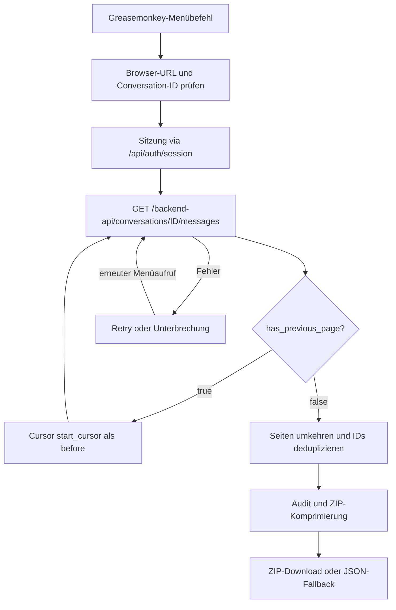

# Architektur, Datenvertrag und Grenzen

## Ziel

Ein dediziertes Greasemonkey-/Tampermonkey-Userscript ruft genau den **aktuell geöffneten Original-Chat** über die vorhandene ChatGPT-Browser-Sitzung ab. Das Programm ist **kein** Scraper des sichtbaren DOMs; es verwendet einen internen, undokumentierten Nachrichten-Endpunkt. Die Funktion kann sich durch Backend-Änderungen jederzeit verändern.

## Komponenten

- `src/exporter-core.js`: URL-/ID-Prüfung, Sitzungsheader, kleine sequentielle Seitenabfragen, Retries, Validierung, In-Memory-Fortsetzung, Zusammenführung und Audit. Ohne Browser-UI testbar.
- `src/profiling.js`: zeitbasierte Messung von Sitzungs-/Nachrichten-HTTP-Antworten, JSON-Parsing, Seiten-/Retry-Statistik, Export-Serialisierung, ZIP-Komprimierung und separat herunterladbarem redigiertem Diagnosebericht. Keine Rohdaten oder Identifikatoren.
- `src/compression.js`: ZIP-32-Einzeldateiarchiv mit CRC32/UTF-8 und DEFLATE über `CompressionStream('deflate-raw')`. Fehlende Browserunterstützung oder Komprimierungsfehler führen zum unveränderten `.json`-Fallback; keine Drittanbieterbibliothek.
- `src/userscript-entry.js`: persistenter UI-Status unabhängig vom DOM-Statusfenster; **Close** entfernt nur das Fenster, nicht den laufenden Export. Fortschritt wird im Speicher weitergeführt, ein erneuter Launcher-Klick bei aktivem Export öffnet das Fenster mit aktivem Cancel, ohne erneut abzurufen. `GM_registerMenuCommand` für Tampermonkey bzw. `GM.registerMenuCommand` für Greasemonkey, zusätzlich ein fester in-Page-Startbutton **unten rechts** mit eigenständigem, animiertem CSS-Spinner, der am aktiven `AbortController`-Lebenszyklus hängt und beim Schließen des Statusfensters sichtbar bleibt, sowie ein darüber platziertes Statusfenster (englische Meldungen), Browser-Kontextprüfung im Klickmoment, Statusfenster, Abbruch über `AbortController`, Blob-/Browser-Download.
- `scripts/build-userscript.js`: deterministische Zusammenführung der Quellen mit Userscript-Metadaten; keine Runtime-CDNs, keine `@require`-Abhängigkeiten.
- `userscripts/chatgpt-conversation-export.user.js`: **installierbares, generiertes Artefakt**, nicht direkt editieren.
- `tests/exporter.test.js`: simulierte API-Antworten, keine realen Chat- oder Sitzungsdaten.



## Bedeutung der API-Seiten

**API pages** sind paginierte Antworten des internen Nachrichten-Endpunkts, **keine** Browserseiten, Chat-Turns oder einzelnen Nachrichten. Eine API-Seite kann sehr viele `message records` enthalten. Die Anzeige verwendet diese beiden Begriffe bewusst getrennt.

## Performance-Diagnose

Das Userscript sammelt minimale In-Memory-Messwerte. Der Bericht wird **nicht automatisch gespeichert**; **Save performance report erscheint erst nach Abschluss, Fehler oder Abbruch**, nicht während des Abrufs oder der Komprimierung. Der JSON-Bericht `chatgpt-export-performance-<timestamp>.json` enthält:

- `requests`: laufende Nummer der API-Seite, Versuch, HTTP-Status, Header-Wartezeit (`fetch_ms`), Body-/JSON-Parsing-Dauer (`parse_ms`) und gegebenenfalls gemeldete `Content-Length`;
- `pages`: Datensatzanzahl, kumulierte Datensätze, Anzahl HTTP-Versuche und aufsummierte Zeiten je erfolgreich validierter Seite;
- `summary`: Seiten-/Datensatzzahlen, Retries, Statusverteilung, Summen, P50/P95 der Header-Wartezeit, aktive Laufzeit über mehrere Versuche und – bei erfolgreichem Abschluss – lokale JSON-Serialisierungsdauer, ZIP-Komprimierungsdauer, Rohgröße, Archivgröße und Kompressionsverhältnis.

**Nicht enthalten**: Chat-URL, Conversation-ID, Cursor, Sitzungs-/Authorization-Token, Request-Header, Nachrichteninhalte oder IDs. Auch die Diagnose kann anhand von Zeitstempeln und Nutzungsmustern Rückschlüsse erlauben; vor Veröffentlichung prüfen.

`fetch_ms` misst die Zeit bis zu HTTP-Response-Headern und ist **nicht** identisch mit der vollständigen Netzwerk-/Backend-Dauer. `parse_ms` umfasst das Lesen/Parsen der Antwort. P50/P95 sind Beobachtungswerte ohne statistische Garantie. `active_run_ms` enthält Wartezeiten, aber nicht die Zeit zwischen einem Abbruch und einer manuellen Fortsetzung. Ohne Network-DevTools/Server-Metriken lassen sich z. B. DNS, TLS und serverseitige Berechnungen nicht einzeln isolieren.

## ZIP-Komprimierung und Format

Nach verifiziertem Paginierungsende wird **derselbe JSON-Inhalt wie bisher** erzeugt; er wird lediglich vor dem Download in ein ZIP-Archiv mit genau einer `.json`-Datei verpackt. Das Archiv verwendet standardmäßige ZIP-32-Header, Dateinamen in UTF-8, CRC32-Integritätsprüfung, einen zentralen Verzeichniseintrag und DEFLATE-Methode 8. Die komprimierten Bytes liefert die browsernative `CompressionStream('deflate-raw')`-API. Bei fehlender Unterstützung oder Komprimierungsfehlern wird **kein defektes ZIP** geschrieben; stattdessen wird ausdrücklich das ursprüngliche JSON heruntergeladen. ZIP64 (>4 GiB) wird nicht angeboten.

Die neue Diagnose enthält `summary.zip_compression_ms`, `summary.download_format`, `summary.exported_json_bytes`, `summary.archive_bytes` und `summary.compression_ratio` zusätzlich zu den bisherigen Feldern. Die Berichtserstellung erfolgt weiterhin nur auf Nutzeraktion nach dem Terminalzustand des Exports. Die Komprimierung ist noch **nicht** in einem realen Firefox-/Tampermonkey-Test verifiziert.

## Bewährtes API-Verhalten

- Gesprächs-URL: `window.location.origin + window.location.pathname`; Original-Chat-ID aus `/c/<UUID>`, auch unter `/g/.../c/<UUID>`.
- Authentifizierung über vorhandenen Browserkontext: `GET /api/auth/session`, `credentials: include`; optionaler `Authorization: Bearer ...`-Header; Token **nur im Speicher**, nicht protokollieren.
- Nachrichten: `GET /backend-api/conversations/{id}/messages?include_has_versions=true&num_turns=1`. `num_turns=1` begrenzt **nicht** die Anzahl technischer Datensätze; Seiten können stark variierende Größen aufweisen.
- Ältere Seiten: `before=<page_info.start_cursor>`, bis `page_info.has_previous_page === false`.
- Doppelte IDs nur bei identischen Daten deduplizieren; widersprüchliche Duplikate, fehlende Cursor oder ungültige/ leere Seiten verhindern einen angeblich vollständigen Download.
- Ausfälle: bis zu vier Versuche bei HTTP 429/500/502/503/504 oder Netzwerkfehlern. Nach einem Abbruch bleiben vollständig validierte Seiten im Tab-RAM; Reload löscht den Fortschritt.
- Wechsel des Chats während des Exports wird erkannt und unterbricht die Ausführung.

## Exportdatei

```json
{
  "export_format": "chatgpt-paginated-conversation-v2",
  "source_url": "https://chatgpt.com/c/<conversation-id>",
  "conversation_id": "<conversation-id>",
  "messages": [],
  "page_metadata": [],
  "local_export_audit": {
    "exported_at": "...",
    "pages_loaded": 0,
    "raw_records": 0,
    "unique_records": 0,
    "duplicate_records": 0,
    "pagination_verified": true,
    "attachments_fetched_separately": false
  }
}
```

Das JSON-Beispiel ist eine **Formillustration**, keine realistische vollständige Exportdatei. Die Seitenmetadaten enthalten originale `page_info`-Attribute und weitere API-Felder; die vollständigen Nachrichtenobjekte werden erhalten. Die Reihenfolge der Seiten wird umgekehrt, **nicht** aber die API-Reihenfolge innerhalb einer Seite. Keine Garantie einer strikt chronologischen Sortierung aller Nachrichten-Verzweigungen.

`pagination_verified:true` bedeutet nur, dass die API das Ende der abgefragten älteren Seiten bestätigt hat. Es garantiert weder alle historischen Versionen / Branches noch externe Anhänge. `attachments_fetched_separately` ist deshalb stets `false`.

## Sicherheit

- `@match https://chatgpt.com/*`, nur gleiche Origin und keine externen Hosts.
- Kein Export ohne expliziten Klick auf Menüeintrag **oder** Export-Button. Der in-Page-Button ist auf `chatgpt.com` auch außerhalb einer Unterhaltung sichtbar; vor dem Start validiert der Exporter die Original-Chat-URL.
- Kein externer Code oder Dienst; ZIP bzw. JSON-Fallback als lokaler Blob-Download.
- Die exportierten Daten können sensible Inhalte enthalten. Keine echten Exporte in Git, Issues oder CI legen. Alle Tests verwenden erfundene IDs und Nachrichten.
- Der Tampermonkey-Export unter Firefox ist für V0.1.1 praktisch bestätigt. Die ZIP-Funktion und das terminale Profiling von V0.1.6 benötigen eine Browserprüfung.

## Bisherige Evidenz

Der **Konsolen-V2-Exporter** (nicht die Greasemonkey-Fassung) wurde am 31.10.2026 für einen sehr langen technischen Chat zweimal erfolgreich verwendet: **64 Seiten, 4.970 eindeutige Datensätze, 0 Duplikate, 55,35 MiB**, Paginierung beendet. Der nicht-paginierte Conversation-Endpunkt scheiterte mit `HTTP 500 {"detail":"Request timeout"}`. Die automatische URL-Erkennung wurde separat im Browser bestätigt.

Der Export wurde unter Tampermonkey in Firefox praktisch bestätigt. Für die neue Version 0.1.7 steht noch die spezifische Browser-Abnahme von **ZIP-Export**, **Fallback**, **Close**, Wiederöffnen und terminalem Profiling aus.
