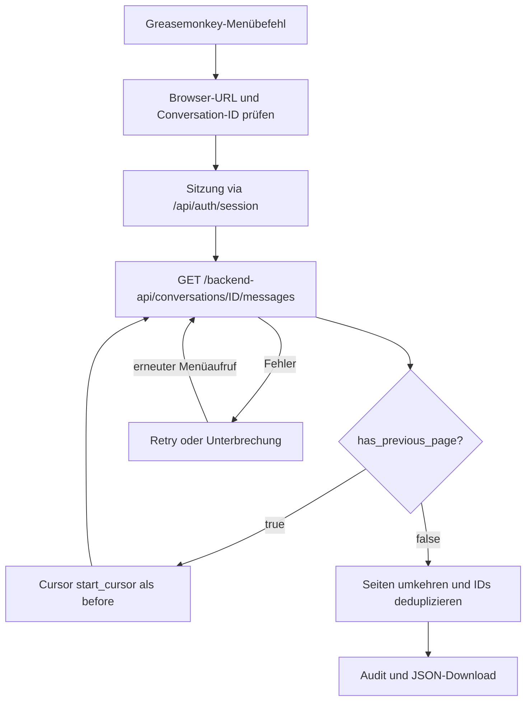

# Architektur, Datenvertrag und Grenzen

## Ziel

Ein dediziertes Greasemonkey-Userscript ruft genau den **aktuell geöffneten Original-Chat** über die vorhandene ChatGPT-Browser-Sitzung ab. Das Programm ist **kein** Scraper des sichtbaren DOMs; es verwendet einen internen, undokumentierten Nachrichten-Endpunkt. Die Funktion kann sich durch Backend-Änderungen jederzeit verändern.

## Komponenten

- `src/exporter-core.js`: URL-/ID-Prüfung, Sitzungsheader, kleine sequentielle Seitenabfragen, Retries, Validierung, In-Memory-Fortsetzung, Zusammenführung und Audit. Ohne Browser-UI testbar.
- `src/userscript-entry.js`: `GM.registerMenuCommand`, Browser-Kontextprüfung im Klickmoment, Statusfenster, Abbruch über `AbortController`, Blob-/Browser-Download.
- `scripts/build-userscript.js`: deterministische Zusammenführung der Quellen mit Userscript-Metadaten; keine Runtime-CDNs, keine `@require`-Abhängigkeiten.
- `userscripts/chatgpt-conversation-export.user.js`: **installierbares, generiertes Artefakt**, nicht direkt editieren.
- `tests/exporter.test.js`: simulierte API-Antworten, keine realen Chat- oder Sitzungsdaten.



## Bewährtes API-Verhalten

- Gesprächs-URL: `window.location.origin + window.location.pathname`; Original-Chat-ID aus `/c/<UUID>`, auch unter `/g/.../c/<UUID>`.
- Authentifizierung über vorhandenen Browserkontext: `GET /api/auth/session`, `credentials: include`; optionaler `Authorization: Bearer ...`-Header; Token **nur im Speicher**, nicht protokollieren.
- Nachrichten: `GET /backend-api/conversations/{id}/messages?include_has_versions=true&num_turns=1`. `num_turns=1` begrenzt **nicht** die Anzahl technischer Datensätze; Seiten können stark variierende Größen aufweisen.
- Ältere Seiten: `before=<page_info.start_cursor>`, bis `page_info.has_previous_page === false`.
- Doppelte IDs nur bei identischen Daten deduplizieren; widersprüchliche Duplikate, fehlende Cursor oder ungültige/ leere Seiten verhindern einen angeblich vollständigen Download.
- Ausfälle: bis zu vier Versuche bei HTTP 429/500/502/503/504 oder Netzwerkfehlern. Nach einem Abbruch bleiben vollständig validierte Seiten im Tab-RAM; Reload löscht den Fortschritt.
- Wechsel des Chats während des Exports wird erkannt und unterbricht die Ausführung.

## Exportdatei

```json
{
  "export_format": "chatgpt-paginated-conversation-v2",
  "source_url": "https://chatgpt.com/c/<conversation-id>",
  "conversation_id": "<conversation-id>",
  "messages": [],
  "page_metadata": [],
  "local_export_audit": {
    "exported_at": "...",
    "pages_loaded": 0,
    "raw_records": 0,
    "unique_records": 0,
    "duplicate_records": 0,
    "pagination_verified": true,
    "attachments_fetched_separately": false
  }
}
```

Das JSON-Beispiel ist eine **Formillustration**, keine realistische vollständige Exportdatei. Die Seitenmetadaten enthalten originale `page_info`-Attribute und weitere API-Felder; die vollständigen Nachrichtenobjekte werden erhalten. Die Reihenfolge der Seiten wird umgekehrt, **nicht** aber die API-Reihenfolge innerhalb einer Seite. Keine Garantie einer strikt chronologischen Sortierung aller Nachrichten-Verzweigungen.

`pagination_verified:true` bedeutet nur, dass die API das Ende der abgefragten älteren Seiten bestätigt hat. Es garantiert weder alle historischen Versionen / Branches noch externe Anhänge. `attachments_fetched_separately` ist deshalb stets `false`.

## Sicherheit

- `@match https://chatgpt.com/*`, nur gleiche Origin und keine externen Hosts.
- Kein Export ohne expliziten Menüaufruf.
- Kein externer Code oder Dienst; JSON als lokaler Blob-Download.
- Die exportierten Daten können sensible Inhalte enthalten. Keine echten Exporte in Git, Issues oder CI legen. Alle Tests verwenden erfundene IDs und Nachrichten.
- Da der Browser-Download aus der Greasemonkey-Sandbox noch nicht real validiert wurde, bleibt dies eine **Entwicklungsfassung**.

## Bisherige Evidenz

Der **Konsolen-V2-Exporter** (nicht die Greasemonkey-Fassung) wurde am 31.10.2026 für einen sehr langen technischen Chat zweimal erfolgreich verwendet: **64 Seiten, 4.970 eindeutige Datensätze, 0 Duplikate, 55,35 MiB**, Paginierung beendet. Der nicht-paginierte Conversation-Endpunkt scheiterte mit `HTTP 500 {"detail":"Request timeout"}`. Die automatische URL-Erkennung wurde separat im Browser bestätigt.

Eine echte Firefox-/Greasemonkey-Abnahme ist als nächster Schritt erforderlich.
